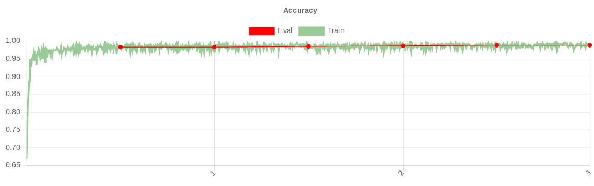
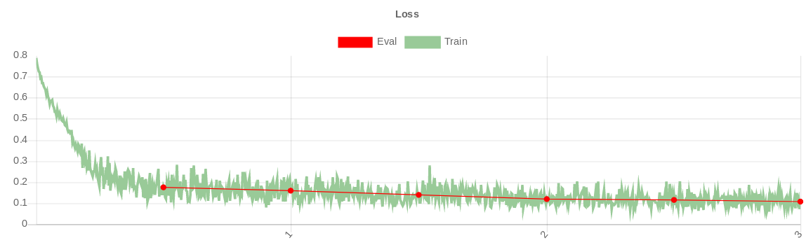

# Crack Semantic Segmentation

Real-time crack segmentation with **PyTorch**, **OpenCV**, and **ONNX Runtime**.

Train a U-Net, export to ONNX, then run folder or video inference.


## Dependencies

- PyTorch
- OpenCV
- ONNX Runtime
- CUDA 9.0+ (optional, for GPU inference)

Install Python deps from `requirements.txt`.

## Workflow

1. Train on your dataset and save weights (`.pt`) with `unet_train.py` (originally used with Supervise.ly).
2. Convert weights to ONNX with `pytorch_to_onnx.py`.
3. Run real-time or batch inference with `crack_det_new.py` / `crack_inference_folder.py`.

Pretrained model files: [Google Drive](https://drive.google.com/file/d/10dSDs6riOSb4dWPtEDRCoqyOtO_Uh7k8/view?usp=sharing)

## Commands

Folder inference (GPU):

```bash
python crack_inference_folder.py \
  -c unet_classes.txt \
  -l unet_colors.txt \
  -idir "sample_dataset/" \
  -odir "output_test/" \
  -m model_files/model.pt
```

Video inference:

```bash
python crack_det_new.py \
  -c unet_classes.txt \
  -l unet_colors.txt \
  -i input_video.mp4 \
  -o output_video.mp4 \
  -m model_files/model.pt
```

## Training curves





## License

MIT — see [LICENSE](LICENSE).
